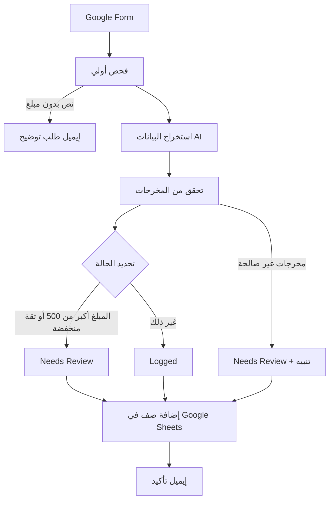

 02 — Workflow Decomposition

Process
تحويل جملة مصروف حرة بالعربية إلى سجل منظم في Google Sheets مع إيميل تأكيد. كل جملة تُسجَّل كصف مستقل. المصاريف الكبيرة أو غير الواضحة تُعلَّم للمراجعة البشرية.

## Workflow Diagram

 Happy Path

1. **استلام الطلب:** أكتب المصروف في Google Form، مثال: "دفعت 45 شيكل غدا مع عميل أمس".
2. **فحص أولي:** النص غير فارغ ويحتوي على رقم.
3. **استخراج البيانات (AI):** المبلغ، العملة، التاريخ، الجهة، التصنيف، ونسبة الثقة.
4. **التحقق من مخرجات الـAI:** المبلغ رقم صالح، والتصنيف من القائمة المسموحة.
5. **تحديد الحالة (Rule):**
   - المبلغ أكبر من 500 ← `Needs Review`
   - الثقة منخفضة ← `Needs Review`
   - غير ذلك ← `Logged`
6. **التسجيل:** إضافة صف جديد في Google Sheets بكل الحقول والحالة.
7. **الإشعار:** إيميل تأكيد بما فهمه النظام، وتنبيه خاص إذا كانت الحالة `Needs Review`.

Tasks / Subtasks

| # | Task | Subtasks | Tool |
|---|------|----------|------|
| 1 | استقبال الإدخال | تعبئة الفورم، تسجيل وقت الإرسال | Google Forms |
| 2 | فحص أولي | النص غير فارغ، يحتوي رقم | Zapier Filter |
| 3 | استخراج البيانات | قراءة الجملة، إخراج الحقول بصيغة ثابتة | AI by Zapier |
| 4 | التحقق | المبلغ رقم، التصنيف ضمن القائمة | Zapier Filter / Formatter |
| 5 | تحديد الحالة | تطبيق حد 500، فحص الثقة | Zapier Paths |
| 6 | التسجيل | إضافة صف بكل الحقول والحالة | Google Sheets Create Row |
| 7 | الإشعار | تأكيد عادي أو تنبيه مراجعة | Gmail |

Dependencies

- لا يمكن استخراج البيانات قبل اجتياز الفحص الأولي.
- لا يمكن تحديد الحالة قبل استخراج المبلغ ونسبة الثقة.
- الإيميل يعتمد على نتيجة التسجيل والحالة النهائية.
 Exception Paths

| Case | Step | What happens |
|------|------|--------------|
| نص بدون مبلغ | 2 | لا يُسجَّل صف، ويصلني إيميل طلب توضيح |
| الـAI لم يستخرج المبلغ أو أعاد قيمة غير صالحة | 4 | `Needs Review` وإيميل تنبيه |
| ثقة الـAI منخفضة | 5 | `Needs Review` |
| المبلغ أكبر من 500 شيكل | 5 | `Needs Review` وإيميل تنبيه |
| تاريخ مستحيل أو عملة غير متوقعة | 4 | `Needs Review` |

 Notes

- **قرار:** لا توجد معالجة للتكرار. كل إدخال يُسجَّل كصف مستقل، فإذا تم الشراء مرتين أُدخله مرتين. هذا يبقي الـWorkflow بسيطًا ويقلل نقاط الفشل.
- صورة الفاتورة اختيارية، ويُحفظ رابطها فقط في الـSheet ولا يحللها الـAI في هذه النسخة.
- كل مسار ينتهي بصف في الـSheet أو إيميل، بحيث لا يضيع أي إدخال بصمت.
