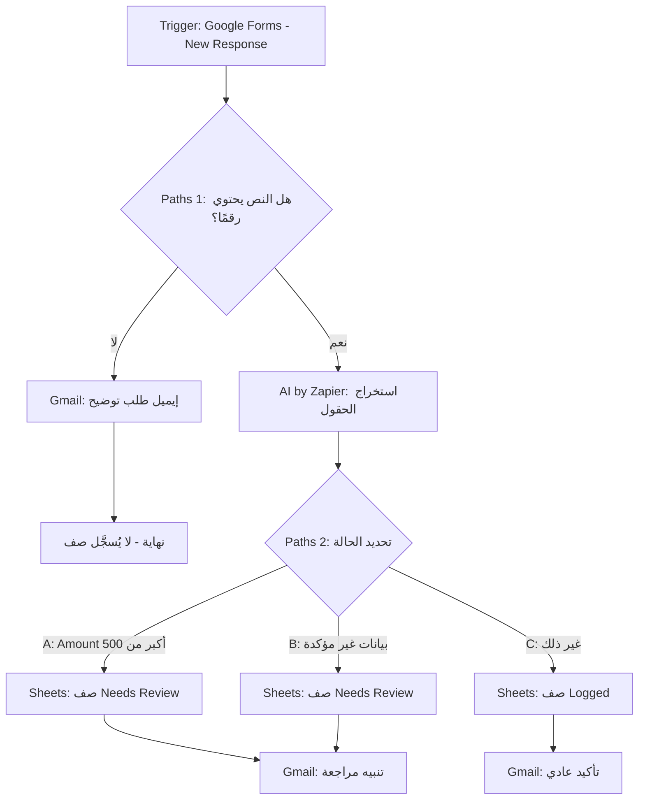

 05 — Automation Design

> هذا الملف تصميم قبل البناء. لا يحتوي على إعدادات Zapier الفعلية، فهذه تُوثَّق في `06-implementation.md`.

 Overview
Zap واحد يستقبل جملة المصروف من Google Form، ويستخرج بياناتها بالـAI، ويطبق قواعد ثابتة لتحديد الحالة، ثم يسجل صفًا في Google Sheets ويرسل إيميلًا.

Final Workflow (Start to End)



Steps

| # | Step | App / Action | Type | Purpose |
|---|------|--------------|------|---------|
| 1 | Trigger | Google Forms: New Response | Trigger | استقبال الجملة |
| 2 | فحص الرقم | Paths 1 | Rule | إيقاف النص الذي لا يحتوي رقمًا |
| 3 | طلب توضيح | Gmail: Send Email | Action | إبلاغي بإعادة الإدخال (المسار الأول فقط) |
| 4 | الاستخراج | AI by Zapier | AI | تحويل الجملة إلى حقول |
| 5 | تحديد الحالة | Paths 2 | Rule | تطبيق شروط المراجعة |
| 6 | التسجيل | Google Sheets: Create Spreadsheet Row | Action | إضافة الصف بالحالة وسببها |
| 7 | الإشعار | Gmail: Send Email | Action | تأكيد أو تنبيه |

 Step 2: Paths 1 (فحص الرقم)

| Path | Condition | Next |
|------|-----------|------|
| No Number | Expense_Text لا يحتوي أي رقم (إنجليزي 0-9 أو عربي ٠-٩) | Gmail طلب توضيح ثم نهاية |
| Has Number | غير ذلك | يكمل إلى AI |

Step 4: AI by Zapier

**Input:** `Expense_Text` و`Submitted_At` (للتاريخ النسبي).

**Output Fields:** Amount, Currency, Expense_Date, Vendor, Category, Confidence.

**Prompt (مسودة):**
```
You extract expense data from a short Arabic sentence.
Today's date is {Submitted_At}. Resolve relative dates (اليوم, أمس, قبل يومين) to YYYY-MM-DD.
Rules:
- Amount: number only (convert Arabic digits to English). Empty if not found.
- Currency: ILS, USD, JOD or EUR. Default ILS if not mentioned.
- Vendor: name of the merchant/place. Empty if not mentioned.
- Category: exactly one of: طعام, مواصلات, برامج واشتراكات, مواد ومستلزمات, أخرى.
- Confidence: High, Medium or Low (Low if the sentence is ambiguous).
- Never guess an amount. If unsure, leave it empty.
```

 Step 5: Paths 2 (تحديد الحالة)

الترتيب مهم: Zapier يقيّم المسارات بالتسلسل، فنضع الحالات الأخص أولًا.

| Path | Conditions | Status | Review_Reason |
|------|------------|--------|---------------|
| A | Amount أكبر من 500 | Needs Review | مبلغ أكبر من 500 شيكل |
| B | أي شرط من: Amount فارغ، Confidence = Low، Currency ≠ ILS، Category = أخرى، Expense_Date بعد اليوم | Needs Review | بيانات غير مؤكدة، راجعي الصف |
| C | غير ذلك | Logged | (فارغ) |

 Step 6: Field Mapping (Google Sheets → `Expenses`)

| Sheet Column | Source |
|--------------|--------|
| Submitted_At | Trigger |
| Expense_Text | Trigger |
| Amount | AI |
| Currency | AI |
| Expense_Date | AI (إن كان فارغًا: تاريخ Submitted_At) |
| Vendor | AI |
| Category | AI |
| Confidence | AI |
| Status | ثابت حسب المسار (Logged / Needs Review) |
| Review_Reason | ثابت حسب المسار |
| Receipt_Link | Trigger |

Step 7: Email Templates

**1. طلب توضيح (Path: No Number)**
- Subject: `لم أستطع تسجيل المصروف`
- Body: `الجملة التي كتبتها لا تحتوي مبلغًا: "{Expense_Text}". أعيدي الإدخال مع المبلغ.`

**2. تأكيد عادي (Status = Logged)**
- Subject: `تم تسجيل مصروف: {Amount} {Currency}`
- Body: `سجلت: {Amount} {Currency} | {Category} | {Vendor} | {Expense_Date}`

**3. تنبيه مراجعة (Status = Needs Review)**
- Subject: `مصروف يحتاج مراجعة: {Amount} {Currency}`
- Body: `السبب: {Review_Reason}. ما فهمه النظام: {Amount} {Currency} | {Category} | {Vendor} | {Expense_Date}. النص الأصلي: "{Expense_Text}".`

Failure Handling
- فشل أي خطوة (Sheets أو Gmail): Zapier يرسل إشعار خطأ، وأعيد تشغيل الـRun من Zap History.
- الـAI يرجع حقلًا فارغًا: يذهب إلى Path B، فلا يضيع الإدخال.

Design Decisions

| Decision | Reason |
|----------|--------|
| Zap واحد وليس عدة Zaps | أسهل في الفهم والاختبار |
| الـAI يستخرج فقط ولا يقرر الحالة | القرارات المالية يجب أن تكون ثابتة ومتوقعة (Rule) |
| فحص الرقم قبل الـAI | يوفر استدعاء AI ويمنع التخمين |
| الحالات الأخص أولًا في Paths | حتى يكون سبب المراجعة دقيقًا |
| لا معالجة للتكرار | كل إدخال صف مستقل (انظر `02-workflow-decomposition.md`) |

Test Plan (يُنفَّذ في الملف 06)

| # | Input | Expected Result |
|---|-------|-----------------|
| 1 | دفعت 45 شيكل غدا مع عميل أمس | Logged، 45 ILS، طعام |
| 2 | اشتراك Canva 60 دولار | Needs Review (عملة USD) |
| 3 | دفعت 700 شيكل ايجار مكتب | Needs Review (أكبر من 500) |
| 4 | اشتريت قهوة | إيميل طلب توضيح، بدون صف |
| 5 | دفعت ٣٠ شيكل تكسي اليوم | Logged، مواصلات (أرقام عربية) |
| 6 | دفعت شي بشي | Needs Review (غير واضح) |
